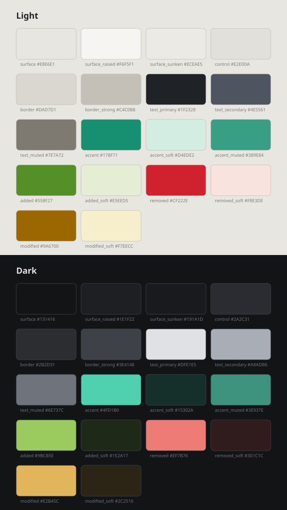

# Visual language

The colour system for the app: eighteen roles, each with a light and a dark
value.



| | |
|---|---|
| [`rules.md`](rules.md) | What the roles are held to — contrast, both modes, colour never alone |
| [`rationale.md`](rationale.md) | Why these values, and what is deliberately not decided here |
| [`palette.svg`](palette.svg) | The sheet above, generated |

**Values live in [`tools/palette.py`](../tools/palette.py)**, which generates
the sheet and checks every pairing:

```bash
python3 docs/design/tools/palette.py
```

## Roles, never shades

Nothing here is called `grey200`. A role survives a palette change; a shade
number does not, and renaming it later means touching every widget that used it.

| Role | Light | Dark | Used for |
|---|---|---|---|
| `surface` | `#E8E6E1` | `#131416` | The window the columns sit on |
| `surface_raised` | `#F6F5F1` | `#1E1F22` | The columns, popovers, cards |
| `surface_sunken` | `#ECEAE5` | `#191A1D` | Inputs, code blocks, the source pane |
| `control` | `#E2E0DA` | `#2A2C31` | The chosen segment, a button that is not the primary one |
| `border` | `#DAD7D1` | `#2B2D31` | Dividers between regions |
| `border_strong` | `#C4C0B8` | `#3E4148` | Control outlines, focus |
| `text_primary` | `#1F2328` | `#DFE1E5` | Body and headings |
| `text_secondary` | `#4E5561` | `#A8ADB6` | Metadata, secondary labels |
| `text_muted` | `#7E7A72` | `#6E737C` | Captions, placeholders |
| `accent` | `#178F71` | `#4FD1B0` | Selection, active state, links |
| `accent_soft` | `#D4EDE2` | `#15302A` | The fill behind an active row |
| `accent_muted` | `#389E84` | `#3E937E` | The accent turned down: a folder's glyph in the tree |
| `added` / `added_soft` | `#558F27` / `#E5EED5` | `#9BCB5E` / `#1E2A17` | Diff: a block that appeared |
| `removed` / `removed_soft` | `#CF222E` / `#F8E3DE` | `#EF7B76` / `#301C1C` | Diff: a block that went |
| `modified` / `modified_soft` | `#9A6700` / `#F7EECC` | `#E2B45C` / `#2C2516` | Diff: a block that changed |

**This table is the only place these values are written.** How they map onto
Flutter's own names is [`components/color-scheme.md`](../components/color-scheme.md),
which links here and never restates them.

---

*See also: [design/](../README.md) · [components/](../components/README.md) · [brand/](../brand/README.md)*
